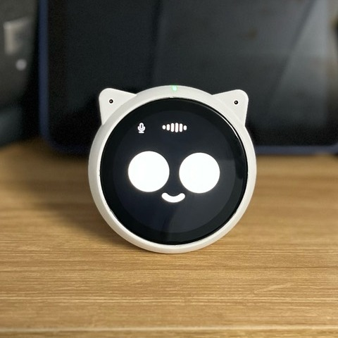
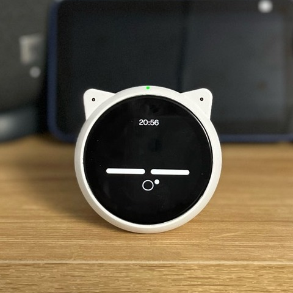
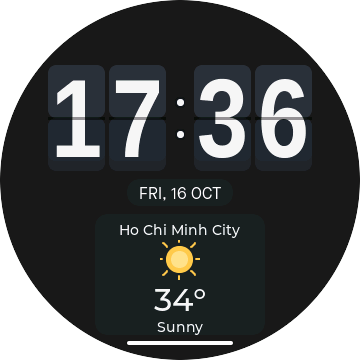
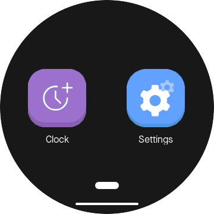
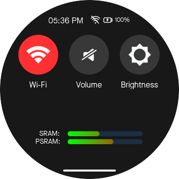
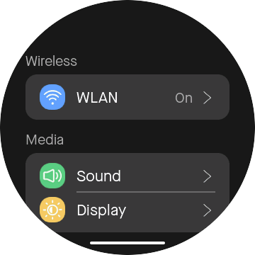

# ESP VoCat AI Chatbot

[](https://github.com/ngttai/esp_chatbot_new/actions/workflows/simulator-ci.yml)

ESP-IDF 6.1 firmware for **ESP VoCat v1.0**, built with ESP-Brookesia and the
ported ESP Speaker UI. The same UI can run on the board or in the Linux/SDL2
simulator.

This project is based on the `example_agent_chatbot` application from the
ESP-Brookesia `master` branch.

## Features

- Launcher, Quick Settings, Clock and Settings UI
- XiaoZhi voice assistant with wake word and touch trigger
- Wi-Fi provisioning, saved networks and SNTP time
- Brightness, volume, battery (`BQ27220`) and factory reset
- Touch sensor and `BMI270` motion gestures
- Linux simulator with deterministic hardware mocks and self-tests

Camera and BLE are not included.

## UI preview

### On device

ESP VoCat v1.0 running the Home emote, photographed on real hardware.

<p align="center">
  
  
</p>

### Simulator

UI adapted from the ESP Speaker example in ESP-Brookesia v0.6, with
project-specific changes.

Screenshots from the Linux simulator. Time, weather, battery and memory values
are simulated and do not represent live device readings.

<table>
  <tr>
    <th>Clock</th>
    <th>Launcher</th>
    <th>Quick Settings</th>
    <th>Settings</th>
  </tr>
  <tr>
    <td></td>
    <td></td>
    <td></td>
    <td></td>
  </tr>
</table>

## Build for ESP VoCat v1.0

```sh
source ~/.espressif/v6.1/esp-idf/export.sh
idf.py bmgr -b esp_vocat_board_v1_0
idf.py build
```

Flash and monitor:

```sh
idf.py -p /dev/ttyACM0 flash monitor
```

## Run the PC simulator

The default setup expects `esp-brookesia` beside this repository:

```sh
cmake -S host_sim -B build-host -G Ninja
cmake --build build-host
./build-host/esp_chatbot_host_sim
```

Run all simulator tests:

```sh
ctest --test-dir build-host --output-on-failure
```

See [host_sim/README.md](host_sim/README.md) for dependencies, optional Linux
backends and simulator limitations.

## Project layout

```text
main/                       Firmware application
main/modules/               Power manager, XiaoZhi, Wi-Fi, IMU, LED and services
main/modules/display/       Display integration and Speaker UI
main/compat/                Renderer pause/resume and LCD panel sleep integration
host_sim/                   Linux/SDL2 simulator
components/                 Local ESP-IDF components
assets/                     UI assets and animations
littlefs/                   Files packaged into LittleFS
docs/                       Release notes, README images and visual baselines
```

The imported Speaker UI is kept under
`main/modules/display/speaker_ui/vendor/esp_speaker_ui/`. Avoid modifying its
layout and assets unless intentionally updating the upstream UI baseline.

Project documentation is indexed in [docs/README.md](docs/README.md).
See [Power management](docs/architecture/power-management.md) for the implemented
state machines and display suspend/resume sequence.

## License

Original project code is licensed under [Apache-2.0](LICENSE), unless otherwise
stated in individual files. Third-party code and assets retain their respective
licenses; see [third-party notices and asset provenance](THIRD_PARTY_NOTICES.md).
