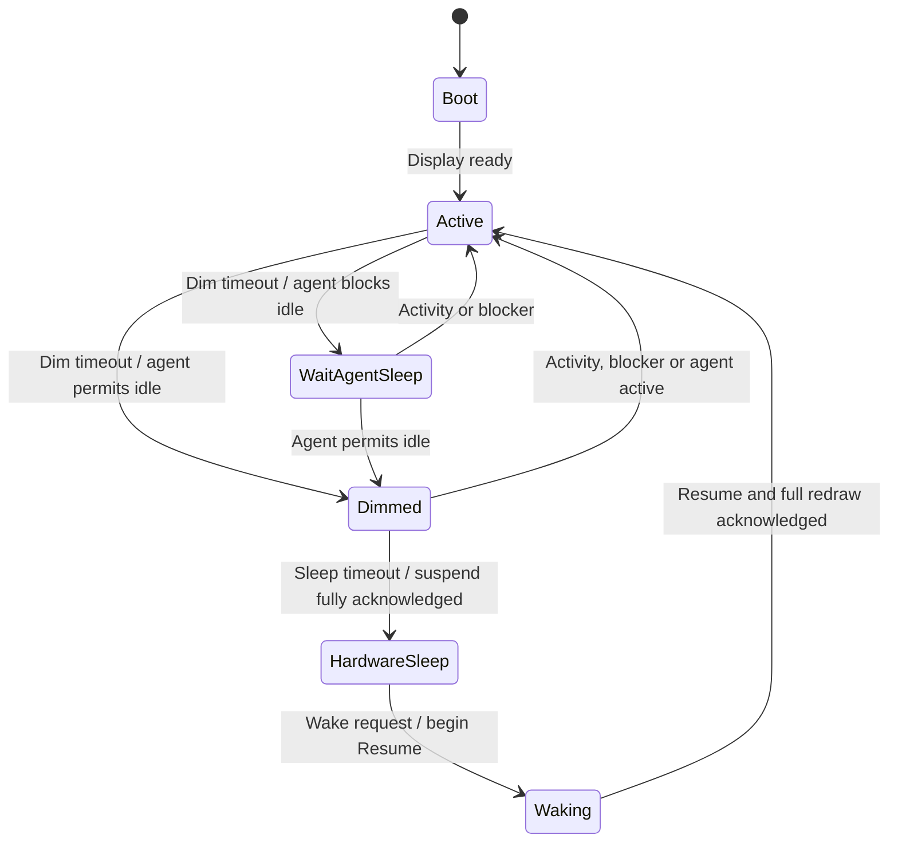
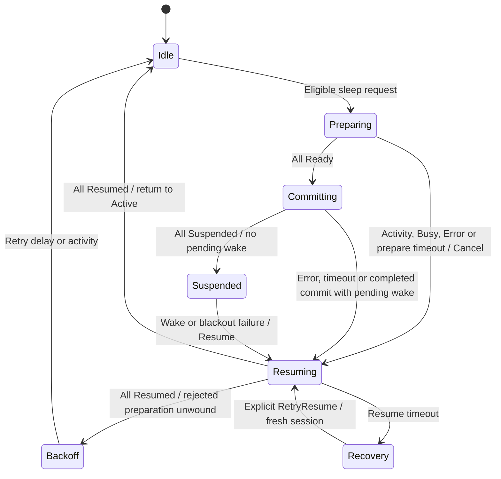
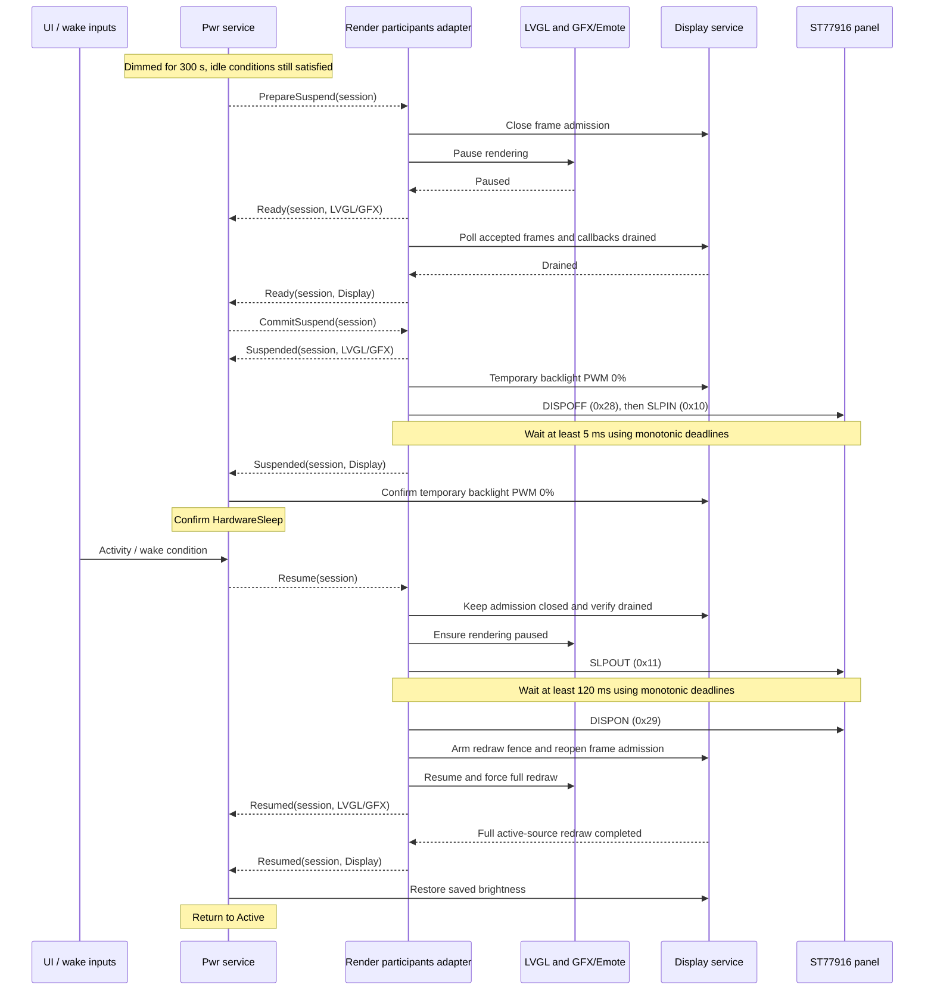

# Power management

This document describes the implemented firmware path, not a future MCU-sleep
design. `Pwr` is a custom Brookesia service. Its policy runs every 50 ms on the
shared service scheduler, independently of LVGL timers. Display participants
reconcile the suspend session every 20 ms on the existing application backend
scheduler. Neither path adds a dedicated task or task stack.

## Policy and timing

| Setting | Default | Meaning |
| --- | --- | --- |
| `EXAMPLE_UI_AUTO_HOME_TIMEOUT_MS` | 30 s | Separate UI navigation policy: return eligible screens to Home |
| `EXAMPLE_PWR_DIM_TIMEOUT_MS` | 60 s | Inactivity before dimming may begin |
| `EXAMPLE_PWR_DIM_BRIGHTNESS_PERCENT` | 10% | Temporary raw backlight PWM, without changing saved brightness |
| `EXAMPLE_PWR_HW_SLEEP_TIMEOUT_MS` | 300 s | Time from entry into Dimmed before requesting suspend |
| `EXAMPLE_PWR_PREPARE_TIMEOUT_MS` | 2 s | Deadline for each Prepare and Commit stage |
| `EXAMPLE_PWR_RESUME_TIMEOUT_MS` | 2 s | Deadline for cancellation/resume acknowledgements |
| `EXAMPLE_PWR_SUSPEND_RETRY_MS` | 5 s | Backoff after rejected/timed-out preparation is unwound |

Defaults are defined in `main/Kconfig.projbuild`; a build can override them.
UI navigation does not itself dim the display or start the panel-sleep sequence.
The power policy applies to the display, not just the Clock screen.

This is the normal service-level flow. During Prepare/Commit, policy remains
Dimmed; the coordinator below tracks progress. `HardwareSleep` is confirmed only
after all required participants acknowledge suspension and backlight blackout
succeeds. During resume, policy can still report `HardwareSleep` until completion;
`Waking` is a policy enum, not a guaranteed separately published transition in
the coordinated path. Failure/recovery is tracked by the coordinator, not by
adding a policy state.

## Inputs and blockers

- Physical input and explicit wake notifications update an activity revision.
  Screen touch, IMU lift (when enabled), head touch and agent activation can wake
  the display through their existing integration paths.
- Display readiness and critical UI operations gate power idle.
- XiaoZhi listening, thinking and speaking block idle. Starting or a pending
  session request also blocks it unless the agent is Slept, Stopped or Error.
  Listening/thinking/speaking take precedence over those idle statuses.
- Agent speaking blocks idle; this predicate is not a general blocker for every
  possible audio player or future music app.
- Opening Launcher/Settings does not imply that XiaoZhi is active. Display wake
  and voice-session wake remain separate; IMU lift does not start a conversation.
- DIM restores brightness on activity; waking from panel sleep restores it only
  after the resume handshake. Both use Display's saved-brightness restore API;
  Pwr does not maintain a second saved-brightness value.

## Suspend coordinator

Required participants are LVGL (ID 1), GFX/Emote (ID 2), and Display (ID 3).
The protocol supports at most eight registered IDs. Registration changes are
allowed outside an active session (Idle/Backoff). Reports carry a session ID;
stale sessions and unexpected reports are rejected. Broadcasts trigger
reconciliation; the current coordinator snapshot is authoritative.

Wake during Commit is latched until Commit finishes or reaches its deadline.
A rejected Prepare is unwound before retrying; activity during that unwind
promotes the result to Active instead of Backoff. Stopping the service during an
active session fences the old session and enters Recovery. Recovery does not
automatically claim Active or reopen a faulted display path.

## Normal suspend and wake sequence

Frame admission covers synchronous, buffered and asynchronous submissions.
Frames accepted before closure must drain, including completion callbacks;
generation fencing prevents obsolete submissions reaching the panel. A source
change during wake restarts the redraw reconciliation. Display reports Resumed
only after a full redraw from the current active source completes.

Panel commands run only with admission closed and output drained. A panel fault
keeps the affected path gated/dark; the coordinator's resume deadline can lead
to Recovery. Backlight restore failures are retried separately and do not write
new saved brightness settings.

## What sleeps, and what stays running

- ST77916 receives actual sleep commands; this is more than backlight-off.
- LVGL refresh is paused, while input/tick/control remain available.
- GFX/Emote rendering and animation timers pause; objects/assets remain allocated
  and animation timing is rebased on resume.
- Display frame transmission is gated and drained, not deinitialized.
- LCD/SD power rails remain on. ESP32 does **not** enter light or deep sleep.
- Wi-Fi, touch, IMU, audio/wake-word, battery and weather services are not
  suspended by this protocol. Their normal independent lifecycle still applies.

The simulator tests policy/protocol behavior with mocks; physical panel sleep
and wake require hardware validation. This design does not claim a measured
whole-device power reduction or suspension of every background service.

## Implementation map

- `main/modules/power_manager.{hpp,cpp}`: service lifecycle, scheduler, events,
  participant API and backlight actions.
- `main/modules/power_policy.hpp`: inactivity/dim policy.
- `main/modules/suspend_coordinator.hpp`: allocation-free handshake state machine.
- `main/modules/display/render_suspend{.hpp,_service.cpp}`: participant adapter,
  pause/drain ordering and redraw completion fence.
- `main/modules/display/panel_power.hpp`: panel command/timing state machine.
- `components/brookesia_service_display/`: frame gate/drain and panel API.
- `main/compat/`: native renderer controls and panel-driver integration.
- `main/modules/display/screens/speaker_shell.cpp`: UI idle inputs/navigation.
- `main/modules/agent_power_activity.hpp`: agent activity classification.
